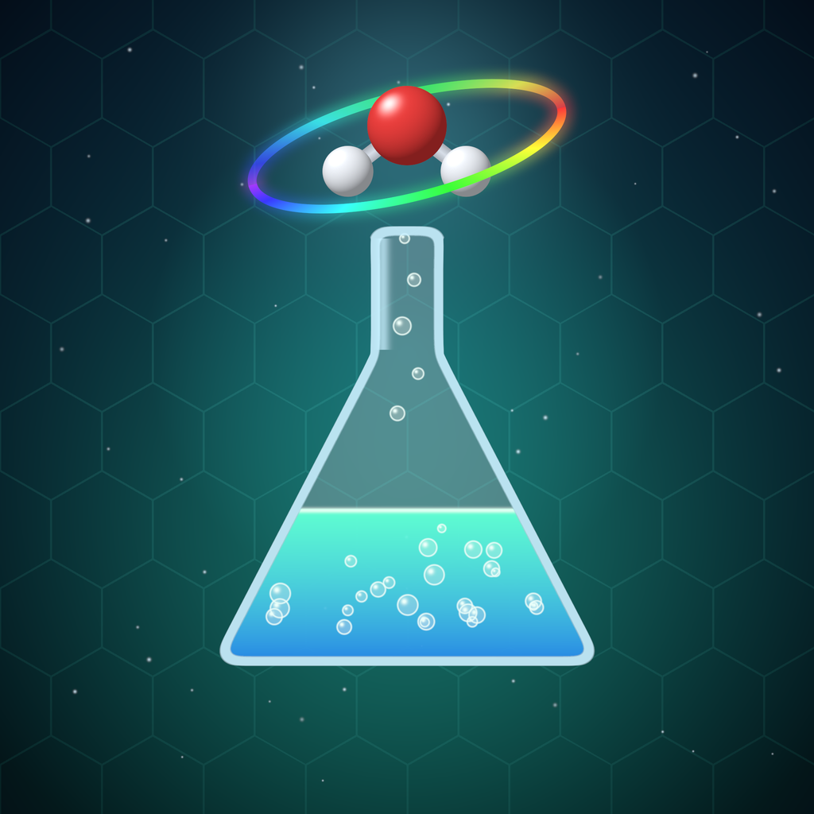
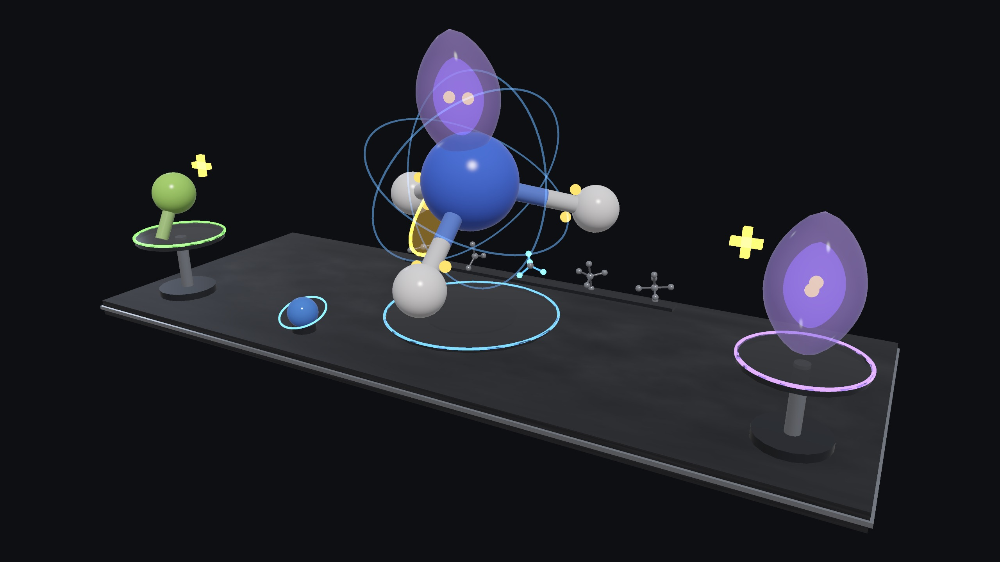
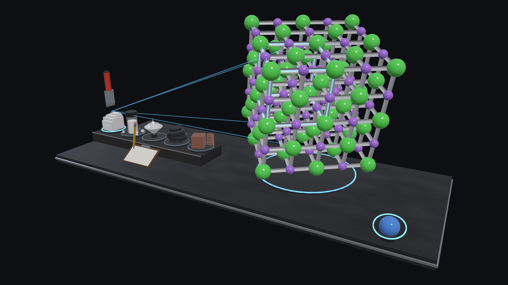
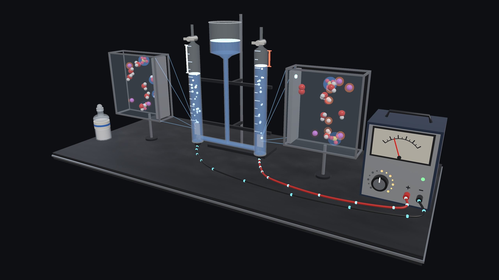
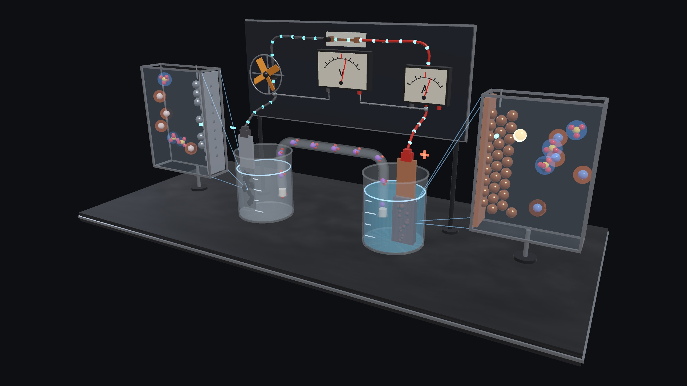
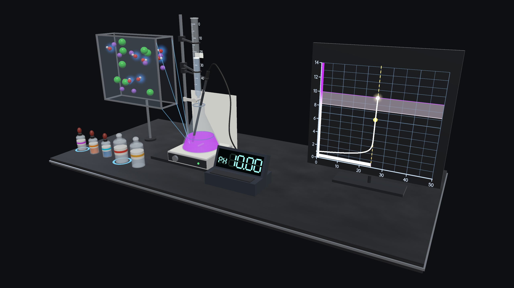
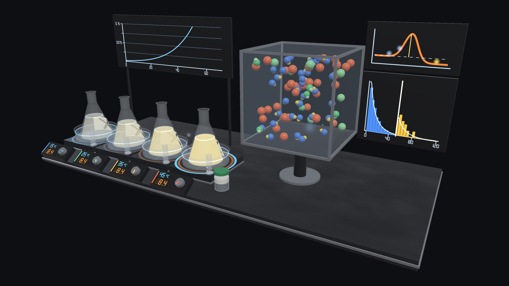
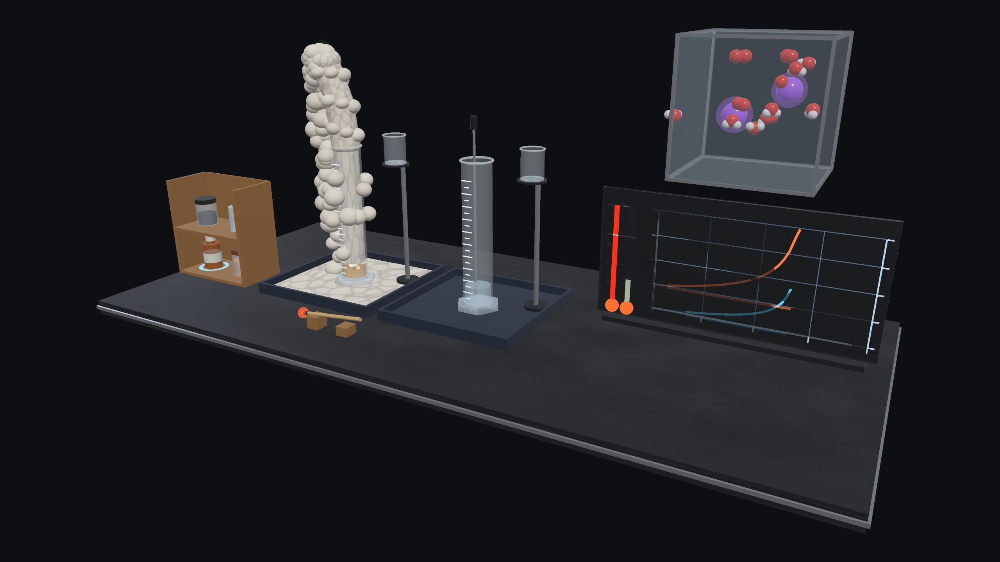

# 化学实验室 Spatial · Chemistry Lab Spatial



9 个化学实验，做成可以**亲手操作**的空间实验台，运行在 PICO 头显（Swan）的 Shared Space 中。每个实验都把
**宏观现象**（烧瓶、颜色、气体、仪表）和**微观分子窗口**并排呈现：你能直接看到分子怎样造成了烧瓶里的变化。
基于 PICO SpatialSDK（Kotlin + Compose）开发；中英双语界面。姊妹作品：物理实验室 Spatial（Physics Lab Spatial）。

*9 chemistry experiments as hands-on spatial lab benches for PICO (Swan) Shared Space. Every one shows the
macroscopic phenomenon next to a molecular window, so you see the molecules cause what the flask shows. Built with
PICO SpatialSDK (Kotlin + Compose). Chinese / English UI. Sister app: Physics Lab Spatial.*

| | |
|---|---|
|  |  |
|  |  |
|  |  |
|  |  |
|  | |

*截图为 2560×1440 无头渲染（`ShowcaseRenderTest`），与头显内的场景同源。
HD stills rendered headlessly from the same scene code that runs on the headset.*

## 实验 · Experiments

| 实验 | Experiment | 你可以做什么 · What you do |
|---|---|---|
| **物质结构 · Structure** | | |
| 焰色反应与原子光谱（Bunsen & Kirchhoff 1860） | Flame Tests & Atomic Spectra | 蘸盐看火焰颜色与 NIST 谱线、钴玻璃、猜未知盐 · Dip salts, read the lines, cobalt glass, identify the unknown |
| 分子构型 · VSEPR（Gillespie–Nyholm 1957） | Molecular Shapes · VSEPR | 添加成键 / 孤对电子，分子在空中自己「长」成正确形状 · Add bonds or lone pairs; the shape self-assembles |
| 晶体结构（Bragg 1913） | Crystal Structures | 走进 NaCl、金刚石、石墨、CsCl、铜的晶格；配位、晶胞计数、劈开盐晶、滑动石墨层 · Walk into lattices; coordination, unit-cell counting, cleave salt, slide graphite |
| **电化学 · Electrochemistry** | | |
| 电解水（Nicholson & Carlisle 1800） | Electrolysis of Water | 调电压、加电解质，H₂ : O₂ = 2 : 1，检验两种气体 · Voltage, electrolyte, the 2 : 1 gases, gas tests |
| 原电池 · 铜锌电池（Daniell 1836） | Galvanic Cell · Daniell | 拿走盐桥电压归零、换电极金属、能斯特方程 · Lift the salt bridge, swap metals, Nernst |
| **反应原理 · Reactions** | | |
| 酸碱中和滴定（Gay-Lussac 1824） | Acid–Base Titration | 逐滴加碱，指示剂变色，实时 pH 曲线；强酸 / 弱酸、三种指示剂 · Drop by drop, the colour change, the live pH curve |
| 化学平衡 · 勒夏特列（Le Chatelier 1884） | Chemical Equilibrium | 冷热水浴与压缩，NO₂⇌N₂O₄ 颜色与分子比例同步变化 · Heat, cool, compress; colour and molecule ratio change together |
| 反应速率 · 碰撞理论（Arrhenius 1889） | Reaction Rates · Collision Theory | 「消失的 X」计时；分子盒里只有越过活化能的碰撞才反应 · The disappearing cross; only collisions above Ea react |
| 大象牙膏 · 催化分解 | Elephant Toothpaste · Catalysis | 换催化剂与浓度，泡沫喷发、碘离子循环、木条复燃 · Catalysts and concentrations; the eruption, the I⁻ cycle, the glowing splint |

## 交互 · Interaction

- **注视 + 捏合**：每个可捏的物体有呼吸光圈；捏中时光圈闪一下，物体上方显示「刚才发生了什么」。
  *Gaze + pinch: pinchable objects have a breathing ring; every pinch flashes it and says what it did.*
- 每个可捏物体在控制面板上都有同名按钮（「物体 → 动作」），两边状态同步。
  *Every pinchable object has a twin button on the panel ("object → action"), kept in sync.*

## 化学计算 · The chemistry

化学核心是纯 Kotlin（`app/src/main/java/.../core/`），测试数值来自真实数据：
- **物质结构**：NIST 原子光谱谱线；CIE 1931 色度计算火焰颜色；晶格常数与 Shannon 离子半径。
- **电化学**：法拉第定律；标准电极电势（CRC）与能斯特方程。
- **反应原理**：
  - 滴定：电荷平衡求精确 pH；
  - 化学平衡：Kp(T) 来自 ΔH° / ΔS°，微观窗口用精确 Gillespie 随机模拟；
  - 反应速率：阿伦尼乌斯方程，配合麦克斯韦–玻尔兹曼碰撞模型；
  - 大象牙膏：动力学与能量守恒。

*Chemistry cores are plain Kotlin, checked by JVM tests against real numbers:*
- *Structure: NIST spectral lines, CIE colorimetry, lattice constants and Shannon radii.*
- *Electrochemistry: Faraday's law, CRC standard potentials and the Nernst equation.*
- *Reactions: charge-balance pH, Kp(T) from ΔH°/ΔS°, exact Gillespie kinetics, Arrhenius with Maxwell–Boltzmann collisions, energy conservation.*

## 构建 · Build

要求 · Requirements：
- JDK 17
- Android SDK 35
- 联网拉取 PICO SpatialSDK 0.13.3（Volcengine Maven，已在 `settings.gradle.kts` 中配置）· *network access for PICO SpatialSDK 0.13.3 (Volcengine Maven, configured in `settings.gradle.kts`)*

```bash
./gradlew :app:testDebugUnitTest     # ~100 JVM tests: chemistry cores, scene contracts, headless render & UI review
./gradlew :app:assembleDebug         # app/build/outputs/apk/debug/app-debug.apk
adb install -r app/build/outputs/apk/debug/app-debug.apk
```

无头评审 · Headless review：
- `LabReviewTest`：用 CPU 渲染每个实验场景。*Renders every scene on the CPU.*
- `UiPreviewTest`：用 Robolectric 渲染真实的 Compose 面板（中英双语），并检查排版。*Renders the real Compose panels in both languages and checks the layout.*
- `ShowcaseRenderTest`（`-Dshowcase=true`）：输出 2560×1440 高清截图。*HD stills.*
- `python3 tools/make_icons.py` / `tools/make_poster.py`：生成图标（含 PICO 3D 图标的各层）与宣传海报。*Icon (incl. PICO 3-D icon layers) and store poster.*

架构与开发约定见 [AGENTS.md](AGENTS.md)。*Architecture and conventions: see [AGENTS.md](AGENTS.md).*
